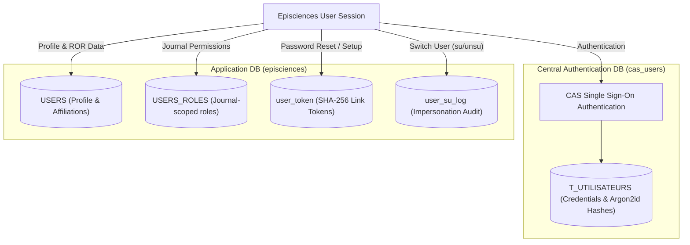

# Authentication, User Tokens & Security Architecture

This document describes the security architecture in Episciences: authentication mechanisms, account link tokens, reviewer invitation HMAC secrets, impersonation (switch-user) audit trails, centralized security logging, and anti-abuse defenses.

---

## 1. Authentication & Dual-Database Design

Episciences operates on a dual-database model separating identity authentication from application-level user profiles:



- **`cas_users` DB:** Manages shared credentials across CCSD platforms (Episciences, HAL, Sciencesconf).
- **`episciences` DB:** Stores local user metadata (`USERS`), journal-specific role assignments (`USERS_ROLES`), and security tokens.

---

## 2. Account Link Tokens (`user_token` Table)

Account activation, password reset, and reviewer account setup links are managed by `Episciences\User\Token\AccountTokenRepository`.

### Token Storage & Integrity
- Tokens are **never stored in plaintext**. Only their **SHA-256 hash** is saved in the `user_token` table (`TOKEN_HASH`).
- Tokens are **strictly single-use** and expire based on configurable Time-To-Live (TTL) values.
- If a user changes their password or email, all existing pending tokens for that account are revoked immediately.

### Purpose-Scoped Tokens (`TokenPurpose`)

| Purpose | Enum Value | Default TTL | Config Key (`config/pwd.json`) | Usage |
|---------|------------|-------------|--------------------------------|-------|
| **Password Reset** | `PASSWORD_RESET` | 3600s (1 hour) | `USER_TOKEN.PASSWORD_RESET_TTL` | Sent on lost password request |
| **Account Activation** | `ACCOUNT_ACTIVATION` | 604800s (7 days) | `USER_TOKEN.ACCOUNT_ACTIVATION_TTL` | Self-registered user account activation |
| **Account Setup** | `ACCOUNT_SETUP` | 1209600s (14 days) | `USER_TOKEN.ACCOUNT_SETUP_TTL` | Sent when an editor creates an account on behalf of a reviewer |

A token generated for `ACCOUNT_ACTIVATION` cannot be used to reset a password or set up an account.

### CLI Maintenance Commands
- [`user:purge-expired-tokens`](./console-commands.md#userpurge-expired-tokens): Daily cron command to delete expired token rows and keep the table compact.
- [`user:import-legacy-tokens`](./console-commands.md#userimport-legacy-tokens): One-off migration tool to import valid legacy tokens from the historical CAS token table.

---

## 3. Reviewer Invitation Tokens (HMAC Protection)

To enable peer reviewers to access invitation forms without requiring immediate authentication, links carry an authenticated cryptographic token (`Episciences\Reviewer\InvitationToken`).

### Cryptographic Design
1. When an invitation is created, a 32-byte cryptographic random secret is saved in `USER_INVITATION.TOKEN`.
2. The URL token parameter is computed as:
   $$\text{Link Token} = \text{HMAC-SHA256}(\text{invitation\_id} + \text{row\_secret}, \text{REVIEWER\_INVITATION.HMAC\_SECRET})$$
3. **Fail-Closed Security:** Forging an invitation URL requires both direct database access (row secret) and access to server credentials in `config/pwd.json`. If `REVIEWER_INVITATION.HMAC_SECRET` is unset, token generation throws a configuration exception.

---

## 4. Impersonation (Switch User) & Audit Trail

Administrators and Chief Editors can impersonate users for troubleshooting or support.

### Impersonation Safeguards (`AccountMutationPolicy`)
While impersonating another user:
- Changing the account's password, email address, or deleting the profile is **strictly forbidden**.
- Restoring the administrator's own session is performed directly via `/user/unsu` (without requiring a full logout/login cycle).

### Local Audit Log (`user_su_log` Table)
Every impersonation lifecycle event is recorded locally via `Episciences\User\SuLogger`:
- **Recorded Fields:** Initiator (`from_uid`), target (`to_uid`), action (`GRANTED`, `DENIED`, `UNSU`), `rvid`, IP address, user agent, and a SHA-256 hash of the session ID.
- **Privacy & GDPR Compliance:** IP addresses older than 365 days are anonymized via [`user:anonymize-su-logs`](./console-commands.md#useranonymize-su-logs) using `/16` (IPv4) or `/48` (IPv6) subnet masks.

---

## 5. Centralized Access & Security Log (`AccessLog`)

Denials and security events across all journals are recorded in a unified daily JSON log:

```
logs/security-YYYY-MM-DD.log
```

Logs are retained for **180 days**.

### Monitored Event Types

| Event Code | Constant | Meaning |
|------------|----------|---------|
| `auth_required` | `AccessLog::AUTH_REQUIRED` | Guest reached protected page; redirected to login |
| `acl_denied` | `AccessLog::ACL_DENIED` | Logged-in user lacks necessary role |
| `acl_missing` | `AccessLog::ACL_MISSING` | Valid controller action missing from `acl.ini` (configuration bug) |
| `csrf_failed` | `AccessLog::CSRF_FAILED` | Form submission failed CSRF token verification |
| `login_failed` | `AccessLog::LOGIN_FAILED` | Bad credentials or failed authentication attempt |
| `token_invalid` | `AccessLog::TOKEN_INVALID` | Expired, forged, or mismatched security token |
| `unsafe_path` | `AccessLog::UNSAFE_PATH` | Path traversal attempt (`../`, control characters) |
| `unknown_resource` | `AccessLog::UNKNOWN_RESOURCE` | XHR request targeting non-existent resource |

### Parameter Redaction (`ParamRedactor`)
Sensitive query parameters (passwords, auth tokens, session cookies, API secrets) are stripped or masked before being written to disk.

---

## 6. CSRF & Anti-Abuse Defenses

- **CSRF Tokens:** All state-changing POST requests (`user/*`, `paper/*`, `review/*`) validate a session-scoped token via `Episciences\Csrf\Helper`.
- **ALTCHA Proof-of-Work:** Account creation and login endpoints integrate ALTCHA challenges (`user/altcha-challenge`) to mitigate automated brute-force attacks without user-tracking cookies.
