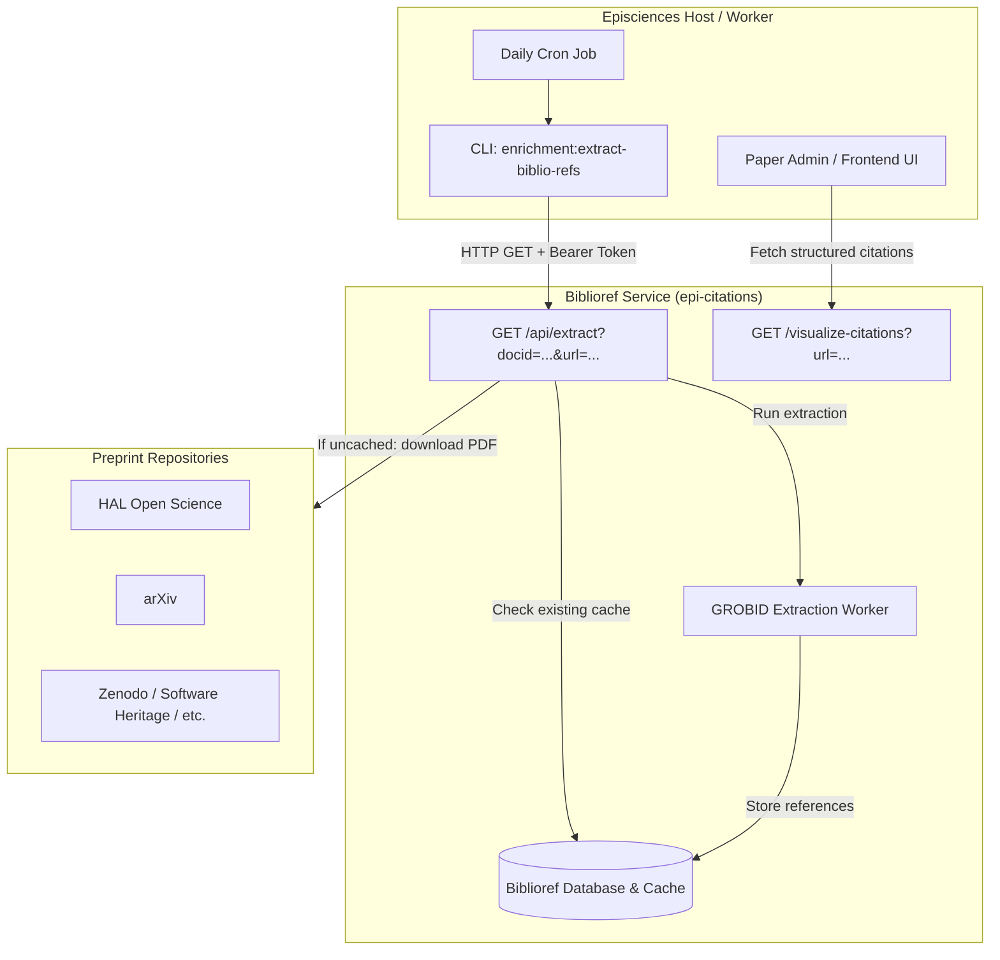

# Bibliographic Reference Extraction Architecture & Lifecycle

This document describes the technical architecture, editorial lifecycle interactions, and operational usage of the Biblioref bibliographic reference extraction system in Episciences.

---

## 1. Overview & Dual Purpose

Episciences extracts and structures bibliographic references from submitted papers using an external **Biblioref** service backed by **GROBID**. This extraction serves two primary objectives:

1. **Scientific Integrity Screening (Problematic Paper Screener / PPS):**
   * References are analyzed to detect known problematic or retracted works (*Feet of Clay*), tortured phrases, citation jacking, paper mills, and automated paper generators (SCIgen, Mathgen).
   * Providing these signals to reviewers and editors **during the review phase** prevents accepting compromised submissions.
2. **Editorial Preparation & Metadata Enrichment:**
   * Validated references are formatted into CSL-JSON and structured XML.
   * Enables downstream delivery to registries and indexes: **Crossref** (`citation_list`), **DOAJ**, and **zbMATH Open** (via zbJATS exports).

---

## 2. Technical Architecture



### Key API Endpoints

* **`GET /api/extract?docid=<DOCID>&url=<PDF_URL>`:**
  * Protected by a Bearer token (`EPISCIENCES_BIBLIOREF['TOKEN']`).
  * If the paper was already processed for this `docid`, returns immediately:
    ```json
    {"success": true, "docId": 12345, "alreadyExtracted": true, "referenceCount": 42}
    ```
  * If not cached, downloads the PDF from `url`, runs GROBID extraction, stores the structured citations in the Biblioref database, and returns:
    ```json
    {"success": true, "docId": 12345, "alreadyExtracted": false}
    ```
* **`GET /visualize-citations?url=<PDF_URL>[&all=1]`:**
  * Returns the structured array of parsed citations with integrity flags (genuine, problematic, detectors).

---

## 3. Paper Lifecycle & Status Mapping

In Episciences, an article entity has a persistent **`PAPERID`**, while each physical document version possesses its own distinct **`DOCID`**.

### Extraction is tied to DOCID creation

References are extracted once per `DOCID`. A status change on an existing `DOCID` does not change the document, so it never requires a new extraction. The command therefore only selects the statuses a new `DOCID` can be created with:

| Status Code | PHP Constant | Where the new DOCID is created |
| :---: | :--- | :--- |
| **0** | `STATUS_SUBMITTED` | New submission (`Episciences_Submit::saveDoc`), or new version without reassigned reviewers (`PaperController::determineNewPaperStatus`) |
| **1** | `STATUS_OK_FOR_REVIEWING` | New version with reassigned reviewers |
| **2** | `STATUS_BEING_REVIEWED` | `Episciences_Submit::saveDoc()` called with a `PAPERID` |
| **4** | `STATUS_ACCEPTED` | New version of an accepted paper (journal does not allow revision after final decision) |
| **28** | `STATUS_ACCEPTED_FINAL_VERSION_SUBMITTED_WAITING_FOR_COPY_EDITORS_FORMATTING` | New version of an accepted paper (journal allows revision after final decision) |
| **23** | `STATUS_CE_READY_TO_PUBLISH` | New version submitted during copy editing |
| **33** | `STATUS_APPROVED_BY_AUTHOR_WAITING_FOR_FINAL_PUBLICATION` | New version submitted during copy editing, after the author approved the journal formatting |

Statuses such as `STATUS_REVIEWED` (`3`) or `STATUS_REVIEWERS_INVITED` (`14`) are always reached on an existing `DOCID` and are not selected. A specific paper in any status can still be processed with `--docid`.

`STATUS_PUBLISHED` (`16`) is selectable with `--published` but is never part of the default selection. Publication keeps the `DOCID` of the accepted version, which was extracted when it was created. Two cases still need it, as a one-off catch-up rather than in the cron:
* papers imported directly as published (`Episciences_Import`, `import:papers`)
* papers published before the extraction command was deployed

Temporary versions (`REPOID = 0`, files uploaded to Episciences instead of a repository) are excluded.

### PDF URL sent to the service

The service stores references by `DOCID` (the `docid` parameter), so the URL is only used to download the PDF.

* Published papers (`16`, with `--published`): the PDF is fetched from the journal site. Journal download URLs only work for published papers.
  * `/articles/{DOCID}/download` when the journal uses the new front (`is_new_front_switched = 'yes'`)
  * `/{DOCID}/pdf` otherwise
* Other statuses: the PDF URL in the repository (`Episciences_Repositories::getPaperUrl()`), then the main file URL, then the repository landing page.

The service only downloads from hosts listed in its `EPISCIENCES_ALLOWED_HOSTS` setting. Papers hosted elsewhere are rejected with HTTP 400 and reported as `failed`.

---

## 4. CLI Command: `enrichment:extract-biblio-refs`

Implemented in `scripts/ExtractBiblioRefsCommand.php` and registered in `scripts/console.php`.

### Command Options

```bash
php scripts/console.php enrichment:extract-biblio-refs [options]
```

* `--docid=<id>`: Force processing of a single DOCID, bypassing any status filter.
* `--rvcode=<code>`: Restrict extraction to papers belonging to a specific journal.
* `--dry-run`: Simulate execution without calling the Biblioref API.
* `--api-url=<url>`: Override `EPISCIENCES_BIBLIOREF['URL']` (useful inside Docker containers).

#### Status Filters

Each option restricts the selection to one DOCID creation status:

* `--submitted` (`0`)
* `--ok-for-reviewing` (`1`)
* `--being-reviewed` (`2`)
* `--accepted` (`4`)
* `--accepted-final-version` (`28`)
* `--ce-ready-to-publish` (`23`)
* `--approved-by-author` (`33`)
* `--published` (`16`, opt-in only)

### Default Selection Logic

* **No status options passed:** extracts all DOCID creation statuses (`[0, 1, 2, 4, 28, 23, 33]`). Published papers are not included.
* **One or more status options passed:** restricts execution **exclusively** to the specified statuses.

### Reference Count Reporting

For every processed paper, the command logs the DOCID, the action and the reference count when the API returns it.

At the end, a summary table (`SymfonyStyle::table`) lists:
* **DOCID**: Document identifier
* **Status**: Option name and numeric code
* **Result**: `extracted`, `already extracted`, `skipped (temporary)`, `failed`, `failed (no url)` or `dry-run`
* **References**: Number of bibliographic references returned by the API (or `-` when omitted)

Papers already extracted are only listed in verbose mode (`-v`), to keep cron output short. Totals (extracted, already cached, skipped, failed) are always logged.

### Catch-up for published papers

```bash
php scripts/console.php enrichment:extract-biblio-refs --published --rvcode=<code>
```

---

## 5. Configuration & Cron Deployment

### `config/pwd.json`

```json
{
  "EPISCIENCES": {
    "BIBLIOREF": {
      "URL": "https://citations.episciences.org",
      "ENABLE": true,
      "SSL_VERIFY": true,
      "TOKEN": "your-bearer-token"
    }
  }
}
```

### Recommended Cron Setup

Run nightly via crontab or container scheduler:

```cron
# Pre-extract references daily at 00:30 UTC for all active papers
30 0 * * * php /var/www/htdocs/scripts/console.php enrichment:extract-biblio-refs --quiet
```
