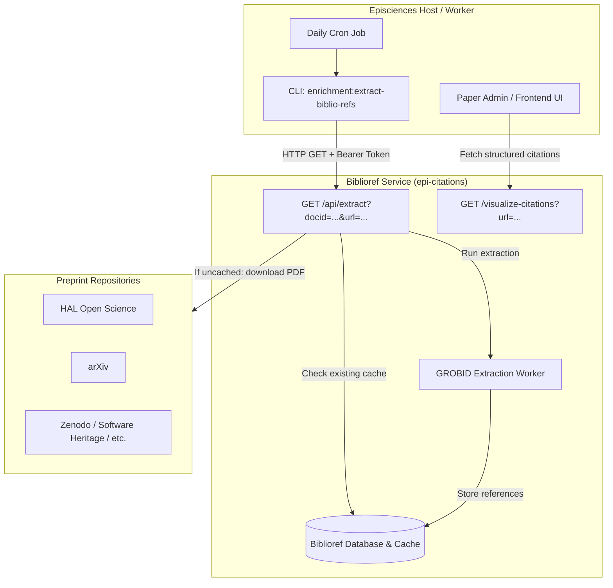

# Bibliographic Reference Extraction Architecture & Lifecycle

This document describes the technical architecture, editorial lifecycle interactions, and operational usage of the Biblioref bibliographic reference extraction system in Episciences.

---

## 1. Overview & Dual Purpose

Episciences extracts and structures bibliographic references from submitted papers using an external **Biblioref** service backed by **GROBID**. This extraction serves two primary objectives:

1. **Scientific Integrity Screening (Problematic Paper Screener / PPS):**
   * References are analyzed to detect known problematic or retracted works (*Feet of Clay*), tortured phrases, citation jacking, paper mills, and automated paper generators (SCIgen, Mathgen).
   * Providing these signals to reviewers and editors **during the review phase** prevents accepting compromised submissions.
2. **Editorial Preparation & Metadata Enrichment:**
   * Validated references are formatted into CSL-JSON and structured XML.
   * Enables downstream delivery to registries and indexes: **Crossref** (`citation_list`), **DOAJ**, and **zbMATH Open** (via zbJATS exports).

---

## 2. Technical Architecture



### Key API Endpoints

* **`GET /api/extract?docid=<DOCID>&url=<PDF_URL>`:**
  * Protected by a Bearer token (`EPISCIENCES_BIBLIOREF['TOKEN']`).
  * If the paper was already processed for this `docid`, returns immediately:
    ```json
    {"success": true, "docId": 12345, "alreadyExtracted": true, "referenceCount": 42}
    ```
  * If not cached, downloads the PDF from `url`, runs GROBID extraction, stores the structured citations in the Biblioref database, and returns:
    ```json
    {"success": true, "docId": 12345, "alreadyExtracted": false}
    ```
* **`GET /visualize-citations?url=<PDF_URL>[&all=1]`:**
  * Returns the structured array of parsed citations with integrity flags (genuine, problematic, detectors).

---

## 3. Paper Lifecycle & Status Mapping

In Episciences, an article entity has a persistent **`PAPERID`**, while each physical document version possesses its own distinct **`DOCID`**.

### Lifecycle Stages & Status Constants

| Status Code | PHP Constant | Label / Meaning | Role in Reference Extraction |
| :---: | :--- | :--- | :--- |
| **0** | `STATUS_SUBMITTED` | Submitted (V1 initial) | Captures all new initial submissions. |
| **1** | `STATUS_OK_FOR_REVIEWING` | Validated for examination | Safety net for V1s approved on the same day prior to cron execution. |
| **2** | `STATUS_BEING_REVIEWED` | Under active review | **Critical:** captures all revised versions (V2, V3...) which start directly in this state. |
| **3** | `STATUS_REVIEWED` | Reviews completed | Editorial decision pending. |
| **14** | `STATUS_REVIEWERS_INVITED` | Reviewers invited | Transition state during reviewer selection. |
| **4** | `STATUS_ACCEPTED` | Paper accepted | Copy-editing phase begins. |
| **16** | `STATUS_PUBLISHED` | Published article | Public article page, Crossref and zbJATS export. |

### The Revised Version Lifecycle Rule

When authors submit a revised manuscript following minor or major revision requests, the submission logic (`Episciences_Submit::savePaper`) creates a new record in `PAPERS` with a **new `DOCID`** and initializes its status directly to:

```php
if ($paperId) {
    $values['PAPERID'] = $paperId;
    $values['STATUS']  = Episciences_Paper::STATUS_BEING_REVIEWED; // Status 2
}
```

> [!IMPORTANT]
> Revised versions **never pass through `STATUS_SUBMITTED` (`0`)**. Therefore, processing only status `0` leaves all revisions un-extracted. Including status `2` (`STATUS_BEING_REVIEWED`) ensures that 100% of revised versions are extracted.

---

## 4. CLI Command: `enrichment:extract-biblio-refs`

Implemented in `scripts/ExtractBiblioRefsCommand.php` and registered in `scripts/console.php`.

### Command Options

```bash
php scripts/console.php enrichment:extract-biblio-refs [options]
```

* `--docid=<id>`: Force processing of a single DOCID, bypassing any status filter.
* `--rvcode=<code>`: Restrict extraction to papers belonging to a specific journal.
* `--dry-run`: Simulate execution without calling the Biblioref API.
* `--api-url=<url>`: Override `EPISCIENCES_BIBLIOREF['URL']` (useful inside Docker containers).

#### Status Filters

* `--submitted`: Only papers with `STATUS_SUBMITTED` (`0`).
* `--ok-for-reviewing`: Only papers with `STATUS_OK_FOR_REVIEWING` (`1`).
* `--being-reviewed`: Only papers with `STATUS_BEING_REVIEWED` (`2`).
* `--reviewed`: Only papers with `STATUS_REVIEWED` (`3`).
* `--reviewers-invited`: Only papers with `STATUS_REVIEWERS_INVITED` (`14`).
* `--accepted`: Only papers with `STATUS_ACCEPTED` (`4`).
* `--published`: Only papers with `STATUS_PUBLISHED` (`16`).

### Default Selection Logic

* **No status options passed:** extracts **all supported statuses** (`[0, 1, 2, 3, 14, 4, 16]`).
* **One or more status options passed:** restricts execution **exclusively** to the specified statuses.

### Reference Count Reporting

For every processed paper, the command tracks and outputs:
1. Progress-bar log message indicating DOCID, action, and reference count.
2. A final ASCII summary table (`SymfonyStyle::table`) displaying:
   * **DOCID**: Document identifier
   * **Status**: Human-readable status name and numeric code
   * **Result**: `extracted`, `already extracted`, `skipped (temporary)`, or `failed`
   * **References**: Number of bibliographic references returned by the API (or `-` when omitted)
3. Total counts: extracted, already cached, skipped, failed.

---

## 5. Configuration & Cron Deployment

### `config/pwd.json`

```json
{
  "EPISCIENCES": {
    "BIBLIOREF": {
      "URL": "https://citations.episciences.org",
      "ENABLE": true,
      "SSL_VERIFY": true,
      "TOKEN": "your-bearer-token"
    }
  }
}
```

### Recommended Cron Setup

Run nightly via crontab or container scheduler:

```cron
# Pre-extract references daily at 00:30 UTC for all active papers
30 0 * * * php /var/www/htdocs/scripts/console.php enrichment:extract-biblio-refs --quiet
```
