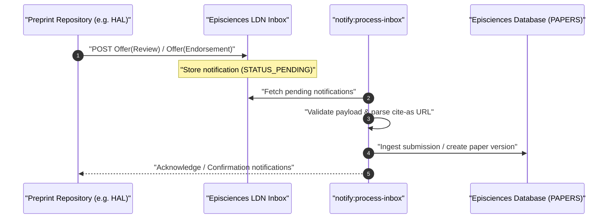
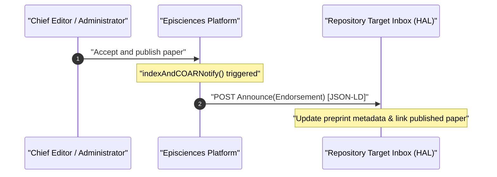

# COAR Notify Protocol & Decentralized Repository Interactions

Episciences implements the [COAR Notify Initiative](https://notify.coar-repositories.org/) protocol to enable decentralized, interoperable communication between overlay journals and preprint repositories (such as [HAL](https://hal.science/)).

Through standard Linked Data Notifications (LDN), authors can submit preprints directly from their repository to an Episciences journal, and journals can notify repositories when papers are accepted, reviewed, or published.

---

## Standards & Protocol Stack

| Specification | Standard | Purpose |
|---------------|----------|---------|
| **W3C LDN** | [Linked Data Notifications](https://www.w3.org/TR/ldn/) | Sender-to-receiver inbox transport via HTTP `POST` |
| **ActivityStreams 2.0** | [W3C ActivityStreams 2.0](https://www.w3.org/TR/activitystreams-core/) | Machine-readable notification vocabulary (`actor`, `object`, `target`, `origin`) |
| **COAR Notify** | [COAR Notify Specifications](https://notify.coar-repositories.org/) | Academic workflow patterns for peer review and endorsement |

All notification payloads are encoded in JSON-LD using `@context`:
```json
{
  "@context": [
    "https://www.w3.org/ns/activitystreams",
    "https://purl.org/coar/notify"
  ]
}
```

---

## Workflow Patterns

### 1. Inbound: Request Review / Endorsement
An author deposits a manuscript in a repository (e.g. HAL) and requests peer review from an Episciences overlay journal.



Supported patterns:
- [`Request Review`](https://notify.coar-repositories.org/patterns/request-review/): Standard peer review request.
- [`Request Endorsement`](https://notify.coar-repositories.org/patterns/request-endorsement/): Journal endorsement request for already-reviewed preprints.

### 2. Outbound: Announce Endorsement / Publication
When an editor accepts and publishes an article in Episciences, the journal automatically sends an outbound notification back to the repository.



Implemented pattern:
- [`Announce Endorsement`](https://notify.coar-repositories.org/patterns/announce-endorsement/): Broadcasts publication, volume, section, DOI, and journal peer-review confirmation.

---

## Inbound Processing: `notify:process-inbox`

Inbound notifications received from external repository inboxes are processed by the Symfony console command [`notify:process-inbox`](./console-commands.md#notifyprocess-inbox) (`scripts/ProcessInboxNotificationsCommand.php`).

```bash
php scripts/console.php notify:process-inbox [options]
```

### Processing Pipeline

1. **Inbox Polling & Deduplication:**  
   Pulls unprocessed notifications from the notifications inbox table. Checks notification UUID to prevent duplicates.
2. **Payload Validation (`PayloadValidator`):**  
   Validates ActivityStreams 2.0 schema, ensures presence of mandatory fields (`id`, `actor`, `object`, `origin`, `target`).
3. **Identifier Resolution (`PreprintUrlParser`):**  
   Resolves the manuscript's persistent identifier (e.g. HAL URL, arXiv ID) and verifies repository availability.
4. **Lifecycle State Detection:**  
   Distinguishes between:
   - `firstSubmission`: Initial article submission to the journal.
   - `newVersion`: Author submitted an updated preprint version in response to a revision request.
   - `versionUpdate`: Metadata-only update.
5. **Outdated State Protection (`STATUS_OUTDATED = -2`):**  
   If a newer version of the paper has already been processed or if the manuscript is already accepted/published, older pending notifications are marked `STATUS_OUTDATED` rather than failing, preventing redundant database updates.
6. **Account & Submission Ingestion:**  
   Resolves the contributor from the author metadata (or creates a provisional account) and triggers the paper creation workflow in `Episciences\Paper`.
7. **Email Notification:**  
   Sends confirmation emails to the contributor and alerts editorial board secretaries (`application/languages/*/emails/inbox_paper_submission_author_copy.phtml`).

### Notification Status Codes

| Code | Constant | Meaning |
|------|----------|---------|
| `0` | `Notification::STATUS_PENDING` | Notification received, waiting to be processed |
| `-1` | `Notification::STATUS_FAILED` | Processing failed due to validation or network error |
| `-2` | `Notification::STATUS_OUTDATED` | Superseded by a newer notification; safely skipped |

---

## Outbound Processing: `Episciences_Notify_Hal`

Outbound notifications are dispatched via `Episciences_Notify_Hal` and `CoarNotifyHttpLayer`, leveraging the `coarnotify/coarnotify-php-client` library.

### Trigger Points
When an article is published via the editorial interface or CLI:
- `AdministratepaperController` or `PaperController` calls `indexAndCOARNotify()`.
- If the paper originates from a HAL repository (`Episciences_Repositories::isFromHalRepository()`), `Episciences_Notify_Hal::announceEndorsement()` is triggered.
- Generates an ActivityStreams 2.0 payload containing:
  - **`actor`**: Journal identity and URL.
  - **`object`**: Published paper URL and DOI.
  - **`context`**: Original preprint identifier (`ietf:cite-as`).
- Dispatches an authenticated HTTP POST with `Content-Type: application/ld+json` to `NOTIFY_TARGET_HAL_INBOX`.

---

## Configuration

Settings are configured in `config/pwd.json`:

```json
{
  "COAR_NOTIFY": {
    "ENABLE": true,
    "TARGET_HAL_INBOX": "https://hal.science/coarnotify/inbox",
    "TARGET_HAL_URL": "https://hal.science"
  }
}
```

| Setting / Constant | Description |
|--------------------|-------------|
| `NOTIFY_TARGET_HAL_INBOX` | URL of the repository inbox accepting LDN POST requests |
| `NOTIFY_TARGET_HAL_URL` | Base origin URL of the target repository |

---

## Logging & Monitoring

- **Inbound processing log:** `logs/inboxNotifications_YYYY-MM-DD.log`
- **Outbound notification log:** `logs/notifyCOAR_YYYY-MM-DD.log`

### Debugging a Specific Notification
If an inbound notification fails, inspect and replay it directly via its UUID:

```bash
php scripts/console.php notify:process-inbox --notification-id=<UUID> -vv
```
