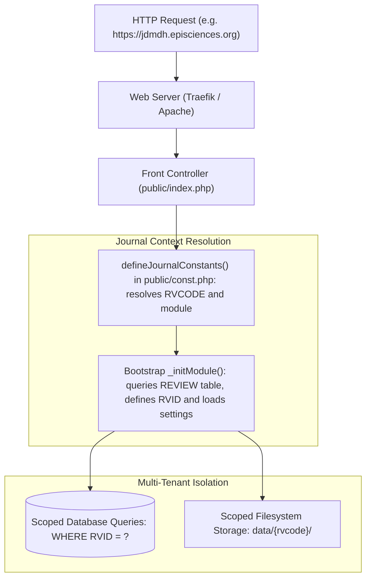

# Multi-Tenancy Architecture & Journal Storage

Episciences is a multi-tenant platform hosting dozens of independent open-access overlay journals on a single codebase, web application instance, and database.

This document details the multi-tenant architecture: domain and virtual host resolution, database scoping, filesystem layout in `data/<rvcode>/`, and role isolation.

---

## High-Level Architecture



---

## 1. Domain Resolution & Modules

Each HTTP request is mapped to a specific context at bootstrap time via `defineJournalConstants()` in [`public/const.php`](../public/const.php):

| Subdomain Pattern | `APPLICATION_MODULE` | `RVID` | Purpose |
|-------------------|----------------------|--------|---------|
| `<rvcode>.episciences.org` | `journal` | `> 0` | Journal public frontend and editorial back-office |
| `manager.<domain>/<rvcode>/` | `journal` | `> 0` | Centralized journal administration interface |
| `episciences.org` / `www.*` | `portal` | `0` | Episciences platform homepage, catalog of journals, and news |
| `oai.<domain>` / `oai-dev.*` | `oai` | `0` | Centralized OAI-PMH repository endpoint |

### Key Global Constants Defined Per Request

- `RVCODE`: String identifier of the journal (e.g. `'jdmdh'`, `'dev'`).
- `RVID`: Integer primary key from the `REVIEW` database table.
- `RVNAME`: Human-readable journal title (e.g. `'Journal of Data Mining and Digital Humanities'`).
- `APPLICATION_MODULE`: Active MVC module (`'journal'`, `'portal'`, `'oai'`, `'common'`).
- `APPLICATION_URL`: Base URL including protocol and domain.
- `REVIEW_PATH`: Absolute filesystem path to the journal's storage directory (`/data/<rvcode>/`).

---

## 2. Database Multi-Tenancy

Episciences uses a shared database with discriminator-column isolation based on `RVID`.

### Journal Registry & Settings
- **`REVIEW` table:** Primary registry of all journals (`RVID`, `CODE`, `NAME`, `STATUS`, `CREATION_DATE`, `EXPIRATION_DATE`).
- **`REVIEW_SETTING` table:** Key-value store (EAV) per journal. Settings include:
  - Editorial policy: open access options, peer-review blind levels (single-blind, double-blind, open peer review).
  - External identifiers: `issn`, `doi_prefix`, Crossref credentials.
  - Appearance: themes, header logos, alert banners.

### Scoped Data Tables
Almost all domain entities require a strict `WHERE RVID = ?` filter:

```sql
SELECT * FROM PAPERS WHERE RVID = :rvid AND PAPERID = :paperid;
SELECT * FROM VOLUMES WHERE RVID = :rvid ORDER BY POSITION ASC;
SELECT * FROM SECTIONS WHERE RVID = :rvid ORDER BY POSITION ASC;
```

Entities partitioned by `RVID` include:
- Articles & Submissions: `PAPERS`, `PAPERS_HISTORY`, `PAPER_STAT`
- Structure: `VOLUMES`, `SECTIONS`, `VOLUME_SECTION`
- Review Process: `REVIEWS_RATINGS`, `COMMENTS`, `REVIEW_INVITATION`
- Communication: `EMAILS` (sent email log), `MAILING_LISTS`
- CMS: `WEBSITE_PAGE`, `WEBSITE_HEADER`

### Role Isolation: `USERS_ROLES`
User accounts reside in a shared CAS/local database, but **roles are strictly journal-scoped**:
- A single user account (`UID`) can be:
  - An **Administrator** or **Chief Editor** on Journal A (`RVID = 1`),
  - An assigned **Editor** or **Reviewer** on Journal B (`RVID = 2`),
  - A regular **Member** on Journal C (`RVID = 3`).
- Permission checks always inspect the current context:
  ```php
  $hasAccess = Episciences_Acl::isAllowed($role, $resource, $privilege);
  ```

---

## 3. Filesystem Multi-Tenancy: `data/<rvcode>/`

Journal-specific configuration, uploaded assets, and CMS pages are isolated in the filesystem under `data/<rvcode>/`.

```
data/<rvcode>/
├── config/
│   ├── navigation.json       # Front-office navigation tree and menu structure
│   └── pwd.json              # Journal-specific secrets (e.g. Next.js revalidation token)
├── layout/
│   ├── header.en.html        # Compiled HTML header for English
│   ├── header.fr.html        # Compiled HTML header for French
│   └── ...                   # Custom footer templates
├── public/
│   ├── css/                  # Custom CSS stylesheets uploaded by editors
│   ├── images/               # Journal logo, banner, and favicon
│   └── files/                # Public downloadable attachments (editorial board guidelines, etc.)
├── pages/                    # Static CMS HTML pages (About, Instructions to Authors)
├── files/
│   ├── documents/            # Uploaded paper PDFs, source files, and author attachments
│   ├── rating_grids/         # Custom evaluation forms (XML grids: grid_0.xml, etc.)
│   └── tmp/                  # Temporary file processing directory
└── languages/
    └── {en,fr}/
        └── emails/           # Custom journal email notification templates
```

### Purpose of Key Directories

1. **`config/navigation.json`:**  
   Defines the public navigation menu. Required for the application to bootstrap; seeded from `src/data/default/config/navigation.json` during journal creation.
2. **`files/documents/`:**  
   Storage for manuscript PDFs and revisions. Files are indexed by `DOCID` and version numbers, never accessible directly via static web paths without ACL verification.
3. **`layout/`:**  
   Cached HTML header and footer files compiled from the database (`WEBSITE_HEADER`). Can be regenerated on demand via [`website:regenerate-headers`](./console-commands.md#websiteregenerate-headers).
4. **`languages/<lang>/emails/`:**  
   Journals can override default system email templates (e.g. reviewer invitation wording, decision notices) without modifying core files.

---

## 4. Journal Lifecycle & Provisioning

New journals are initialized using the [`journal:create`](./console-commands.md#journalcreate) console command:

```bash
php scripts/console.php journal:create \
  --rvcode=newjournal \
  --name="New Journal Title" \
  --lang=en \
  --template=default \
  --admin-uid=42
```

This automated procedure:
1. Inserts the new row into `REVIEW`.
2. Clones settings, default menu items, and appearance from a template journal.
3. Provisions the full directory tree in `data/<rvcode>/` with correct ownership and permissions.
4. Grants the specified `admin-uid` administrator rights on the new journal.

For detailed operational instructions, see [Journal Provisioning Guide](./journal-provisioning.md).
